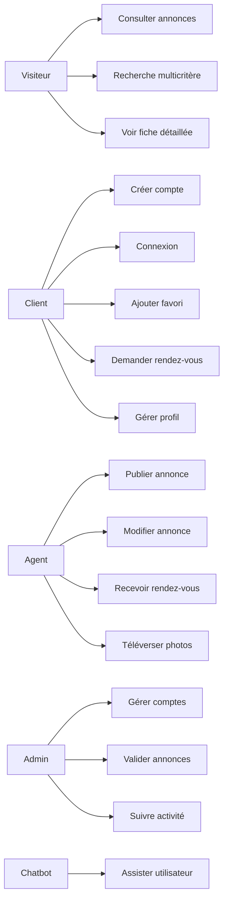
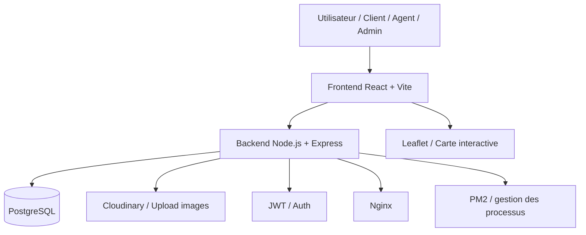
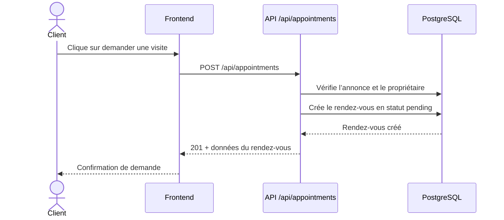
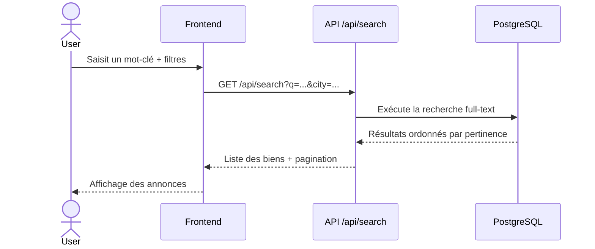

# Cahier de charges détaillé

## Projet : Dari.tn

### Étudiant / auteur
Nom : [À compléter]

### Encadrant académique
Nom : [À compléter]

### Établissement
[Nom de l’établissement]

### Année universitaire
2025 / 2026

---

## Sommaire

1. Identification du projet
2. Objectifs du projet
3. Périmètre du projet
4. Acteurs et rôles
5. Cas d’usage métier
6. Diagramme des cas d’usage
7. Processus métier détaillés
8. Diagramme d’architecture fonctionnelle
9. Architecture technique projet
10. Modèle de données
11. Règles métier essentielles
12. APIs disponibles et utiles dans le projet
13. Diagramme de séquence – création de rendez-vous
14. Diagramme de séquence – recherche immobilière
15. Fonctionnalités métier avancées à développer
16. Exigences non fonctionnelles
17. Critères d’acceptation
18. Déploiement et exploitation
19. Plan de développement possible
20. Planning de mise en œuvre
21. Budget estimatif
22. Conclusion
23. Fichiers de référence du projet

---

## 1. Identification du projet

### 1.1 Nom du projet
Dari.tn

### 1.2 Type de projet
Application web full-stack de vente et location immobilière en Tunisie.

### 1.3 Contexte
Le marché immobilier tunisien souffre encore d’une fragmentation des offres, d’une faible traçabilité des échanges et d’un manque de visibilité pour les biens immobiliers. Les particuliers, agents immobiliers et administrateurs doivent souvent passer par plusieurs canaux non centralisés pour publier, rechercher et gérer des annonces.

Dari.tn a pour objectif de centraliser cette chaîne de valeur dans une plateforme unique, sécurisée et professionnelle, avec un front-office public et un back-office de gestion.

### 1.4 Objectif général
Créer une plateforme immobilière web capable de :
- publier et gérer des annonces immobilières ;
- permettre une recherche avancée avec filtres et carte ;
- sécuriser les échanges entre visiteurs, clients et agents ;
- offrir un espace d’administration pour superviser les contenus et les comptes ;
- préparer le socle pour des fonctionnalités métier avancées telles que les rendez-vous, le chatbot, les alertes et l’aide à la décision.

---

## 2. Objectifs du projet

### 2.1 Objectifs fonctionnels
- Gérer les comptes utilisateurs avec inscription, authentification et rôles.
- Permettre la publication, consultation, modification et suppression d’annonces immobilières.
- Mettre en place une recherche multicritère et full-text.
- Gérer les favoris et les photos de couverture.
- Assurer la sécurité des accès et le contrôle d’autorisation.
- Supporter les rendez-vous de visite pour un bien donné.
- Offrir une interface d’administration aux responsables.

### 2.2 Objectifs techniques
- Développer une API REST robuste et documentée.
- Utiliser une base de données PostgreSQL avec Sequelize.
- Sécuriser les échanges via JWT et middlewares d’authentification.
- Mettre en place un système de validation, gestion des erreurs et logs.
- Préparer la solution pour le déploiement sur un environnement VPS / Nginx / PM2.

### 2.3 Objectifs métier avancés
- simplifier la mise en relation entre acheteur/locataire et agent ;
- réduire le temps de publication des annonces ;
- améliorer la mise en valeur des biens via photos et géolocalisation ;
- assister l’utilisateur dans sa recherche immobilière ;
- donner plus de visibilité aux agents immobiliers et administrateurs.

---

## 3. Périmètre du projet

### 3.1 Périmètre in-scope (non couvert dans cette version)
- paiement en ligne ;
- paiement de comission de l’agence ;
- système de messagerie interne complet ;
- CRM avancé multi-agences ;
- IA générative de description immobilière en production complète ;
- analytics marketing sophistiqués ;
- intégration bancaire ou opérateur mobile.

### 3.2 Périmètre couvert par le projet actuel
- front-office public pour la recherche et la consultation ;
- espace client connecté pour gestion profil et favoris ;
- espace agent pour publication de biens et gestion des visites ;
- espace admin pour supervision des comptes et annonces ;
- backend API REST + base PostgreSQL ;
- upload d’images ;
- recherche géographique ;
- gestion de rendez-vous.

---

## 4. Acteurs et rôles

### 4.1 Visiteur non authentifié
- consulte les annonces publiques ;
- filtre les biens ;
- effectue des recherches ;
- accède à la fiche détail d’un bien.

### 4.2 Client / particulier
- s’inscrit et se connecte ;
- consomme ses annonces favorites ;
- demande un rendez-vous pour visiter une propriété ;
- consulte son profil.

### 4.3 Agent immobilier
- publie des biens ;
- modifie ses annonces ;
- reçoit les demandes de rendez-vous ;
- gère les visites d’un bien ou d’un portefeuille.

### 4.4 Administrateur
- valide les comptes et rôles ;
- supervise les annonces ;
- active ou désactive les comptes ;
- accède aux statistiques du système.

### 4.5 Modérateur / supervision (extension métier)
- vérifie les annonces non conformes ;
- gère les signalements ;
- suspend les publications suspectes.

---

## 5. Cas d’usage métier

### 5.1 Liste des cas d’usage principaux

1. UC01 – Consulter les annonces publiques
   - Un visiteur accède à la page d’accueil et visualise les annonces actives.

2. UC02 – Rechercher un bien
   - Un utilisateur filtres par ville, prix, surface, transaction, type de bien, etc.

3. UC03 – Chercher via mots-clés et suggestions
   - Le système propose des suggestions de villes et de localisations.

4. UC04 – Consulter un détail de bien
   - Le visiteur voit le descriptif, les photos, le prix, la localisation et les données techniques.

5. UC05 – Créer un compte utilisateur
   - Le visiteur s’inscrit avec prénom, nom, email, téléphone et mot de passe.

6. UC06 – Se connecter et gérer son profil
   - L’utilisateur consulte son profil et modifie ses informations.

7. UC07 – Publier une annonce
   - Un agent ou un utilisateur authentifié crée une annonce avec les informations du bien.

8. UC08 – Modifier ou supprimer une annonce
   - Le propriétaire modifie les champs et le statut de l’annonce.

9. UC09 – Ajouter ou retirer un favori
   - Un utilisateur garde une liste d’annonces préférées.

10. UC10 – Ajouter des photos d’annonce
   - Le propriétaire téléverse plusieurs images et choisit la couverture.

11. UC11 – Demander un rendez-vous
   - Un client souhaite visiter un bien et envoie une demande à l’agent.

12. UC12 – Gérer un rendez-vous
   - L’agent confirme, annule, reprogramme ou clôture le rendez-vous.

13. UC13 – Administrer les comptes
   - L’admin active, désactive ou change le rôle d’un utilisateur.

14. UC14 – Superviser les annonces
   - L’admin consulte l’état des annonces et leur statut.

15. UC15 – Utiliser le chatbot d’assistance
   - Le visiteur peut poser des questions sur les biens ou sur le site.

---

## 6. Diagramme des cas d’usage

---

## 7. Processus métier détaillés

### 7.1 Processus de publication d’une annonce
1. L’agent ou l’utilisateur connecté accède au formulaire de publication.
2. Il renseigne les informations de base du bien : titre, description, ville, gouvernorat, adresse, prix, surface, type, transaction, etc.
3. Le système génère un slug unique.
4. Le bien est enregistré avec le statut par défaut selon le rôle :
   - agent/admin : actif ou validé ;
   - utilisateur standard : en attente de validation.
5. L’utilisateur ajoute des images, puis choisit la couverture.
6. Le bien devient visible dans la liste publique selon son statut.

### 7.2 Processus de recherche immobilière
1. Le visiteur saisit un mot-clé ou sélectionne des filtres.
2. Le backend applique une recherche textuelle et des filtres SQL/Sequelize.
3. La plateforme retourne les résultats triés par pertinence, prix ou date.
4. Les résultats peuvent être présentés sous forme de liste ou de carte.
5. L’utilisateur peut consulter la fiche détaillée d’un bien.

### 7.3 Processus de demande de rendez-vous
1. Un prospect voit une annonce immobilière.
2. Il clique sur “Demander une visite”.
3. Le système vérifie :
   - annonce existante ;
   - date dans le futur ;
   - le demandeur n’est pas le propriétaire ;
4. Le rendez-vous est créé avec statut “pending”.
5. L’agent reçoit la demande et peut la confirmer, la reprogrammer ou l’annuler.

### 7.4 Processus de gestion des favoris
1. L’utilisateur authentifié clique sur l’icône favori.
2. Le backend vérifie si l’annonce est déjà dans les favoris.
3. Si oui, on le retire ; sinon on l’ajoute.
4. La liste des favoris est affichée dans l’espace personnel.

### 7.5 Processus d’administration
1. L’admin consulte la liste des utilisateurs et annonces.
2. Il peut modifier le statut d’un compte ou son rôle.
3. Il peut activer/désactiver la publication d’une annonce.
4. Il accède aux statistiques et au journal d’activité.

---

## 8. Diagramme d’architecture fonctionnelle

---

## 9. Architecture technique projet

### 9.1 Frontend
Technologies utilisées dans le projet :
- React
- Vite
- React Router
- Zustand pour l’état global
- Axios pour les appels API
- Leaflet pour la carte
- CSS modules et styles dédiés

### 9.2 Backend
Le backend est structuré selon une organisation claire :
- app.js : configuration Express
- routes/ : définition des endpoints
- controllers/ : logique métier
- middlewares/ : authentification, validation, erreurs
- models/ : modèles Sequelize
- config/ : base de données, migrations et seed
- utils/ : JWT, logger, slugify

### 9.3 Base de données
Les entités majeures sont :
- User
- Listing
- ListingImage
- Favorite
- Message
- RefreshToken
- Appointment

Les relations principales :
- User → Listing : un utilisateur publie plusieurs annonces.
- Listing → ListingImage : une annonce a plusieurs images.
- User ↔ Listing : relation many-to-many via Favorite.
- Listing ↔ User : relation de rendez-vous via Appointment.

---

## 10. Modèle de données

### 10.1 Entité User
Attributs principaux :
- id
- first_name
- last_name
- email
- phone
- password_hash
- role : user / agent / admin
- avatar_url
- is_verified
- is_active
- last_login_at

### 10.2 Entité Listing
Attributs principaux :
- id
- user_id
- title
- slug
- description
- transaction : Vente / Location
- property_type : Appartement, Maison, Villa, Terrain, Bureau, etc.
- city
- governorate
- address
- price
- surface
- rooms
- bedrooms
- bathrooms
- is_furnished
- has_parking
- has_pool
- status : active / pending / sold / rented / archived
- featured
- views_count
- latitude / longitude

### 10.3 Entité Appointment
Attributs principaux :
- id
- listing_id
- requester_id
- agent_id
- scheduled_at
- status : pending / confirmed / rescheduled / cancelled / completed
- contact_phone
- note
- agent_note

### 10.4 Entité Favorite
- user_id
- listing_id

### 10.5 Entité ListingImage
- id
- listing_id
- url
- public_id
- is_cover
- position

---

## 11. Règles métier essentielles

### 11.1 Authentification
- Un utilisateur ne peut pas se connecter si son compte est inactif.
- Les tokens sont délivrés en paire : accessToken + refreshToken.
- Le refresh token est stocké et peut être invalidé lors de la déconnexion ou du changement de mot de passe.

### 11.2 Publication d’annonce
- Le propriétaire de l’annonce peut la modifier ou la supprimer.
- Un admin peut modifier toute annonce.
- Les champs critiques comme l’identifiant, le slug, les vues et les métadonnées ne sont pas modifiables directement.

### 11.3 Recherche
- La recherche full-text est orientée sur les champs de texte et de localisation.
- Les filtres doivent être cohérents avec les types de données (prix, surface, ville, etc.).
- Les annonces non actives ne sont pas visibles publiquement.

### 11.4 Favoris
- Un favori est unique par couple (utilisateur, annonce).
- Le système supporte un toggle “ajouter / retirer”.

### 11.5 Rendez-vous
- Une date future est obligatoire.
- Un propriétaire ne peut pas demander un rendez-vous pour son propre bien.
- L’agent ou l’admin peut modifier le statut.
- Un rendez-vous peut être annulé par l’un des deux acteurs ou l’admin.

### 11.6 Sécurité
- les routes protégées utilisent un middleware d’authentification ;
- les accès admin sont limités via requireRole ;
- les payloads sont validés avant traitement ;
- les limites de requêtes et les CORS sont configurés.

---

## 12. APIs disponibles et utiles dans le projet

### 12.1 API authentification

| Méthode | Route | Description |
|---|---|---|
| POST | /api/auth/register | Inscription d’un utilisateur |
| POST | /api/auth/login | Connexion |
| POST | /api/auth/refresh | Renouvellement du token |
| POST | /api/auth/logout | Déconnexion |
| GET | /api/auth/me | Profil de l’utilisateur connecté |
| PUT | /api/auth/change-password | Changement de mot de passe |

### 12.2 API annonces

| Méthode | Route | Description |
|---|---|---|
| GET | /api/listings | Liste des annonces avec filtres |
| GET | /api/listings/:id | Détail d’une annonce |
| POST | /api/listings | Création d’une annonce |
| PUT | /api/listings/:id | Modification |
| DELETE | /api/listings/:id | Suppression |
| PATCH | /api/listings/:id/status | Changement de statut |
| GET | /api/listings/user/me | Mes annonces |
| POST | /api/listings/:id/message | Envoyer un message de contact |

### 12.3 API recherche

| Méthode | Route | Description |
|---|---|---|
| GET | /api/search?q=... | Recherche full-text |
| GET | /api/search/suggest?q=... | Suggestions |
| GET | /api/search/map-stats | Statistiques géographiques |

### 12.4 API favoris

| Méthode | Route | Description |
|---|---|---|
| GET | /api/favorites | Liste des favoris |
| POST | /api/favorites/:listingId | Ajouter ou retirer un favori |

### 12.5 API utilisateurs

| Méthode | Route | Description |
|---|---|---|
| GET | /api/users/profile | Profil utilisateur |
| PUT | /api/users/profile | Mise à jour du profil |
| GET | /api/users/:id/listings | Annonces d’un agent |
| GET | /api/users | Liste des utilisateurs |
| PATCH | /api/users/:id/status | Activation / désactivation |

### 12.6 API upload / médias

| Méthode | Route | Description |
|---|---|---|
| POST | /api/upload/listings/:id/images | Téléversement d’images |
| DELETE | /api/upload/images/:imageId | Suppression d’une image |
| PATCH | /api/upload/images/:imageId/cover | Définir la photo de couverture |

### 12.7 API rendez-vous

| Méthode | Route | Description |
|---|---|---|
| POST | /api/appointments | Créer un rendez-vous |
| GET | /api/appointments/me | Voir mes rendez-vous |
| GET | /api/appointments/agent | Voir les rendez-vous reçus |
| PATCH | /api/appointments/:id/status | Modifier le statut |
| PATCH | /api/appointments/:id/cancel | Annuler un rendez-vous |

### 12.8 API avancées proposées pour la version d’évolution

| Méthode | Route | Description |
|---|---|---|
| GET | /api/notifications | Notifications |
| PATCH | /api/notifications/:id/read | Marquer comme lu |
| GET | /api/conversations | Conversations |
| GET | /api/conversations/:id/messages | Messages d’une conversation |
| POST | /api/conversations/:id/messages | Envoyer un message |
| POST | /api/search-alerts | Créer une alerte |
| GET | /api/search-alerts | Voir mes alertes |
| GET | /api/moderation/listings | Annonces à valider |
| PATCH | /api/moderation/listings/:id/approve | Approuver une annonce |
| POST | /api/tools/price-estimation | Estimation de prix |
| POST | /api/tools/loan-simulation | Simulation de crédit |

---

## 13. Diagramme de séquence – création de rendez-vous

---

## 14. Diagramme de séquence – recherche immobilière

---

## 15. Fonctionnalités métier avancées à développer

### 15.1 Rendez-vous et visites
- demande de visite pour un bien donné ;
- confirmation / reprogrammation / annulation ;
- historique des visites ;
- rappel avant la date prévue.

### 15.2 Assistant intelligent / chatbot
- réponse à des questions de base sur les biens ;
- aide à la recherche ;
- recommandation de biens selon le profil utilisateur ;
- support en français / arabe.

### 15.3 Alertes de recherche
- alerte mail ou notification sur de nouveaux biens ;
- critères type, ville, budget, superficie ;
- déclenchement automatique lors de publication d’une annonce.

### 15.4 Estimation de prix assistée
- calcul basé sur ville, type, surface, ancienneté, étage, commodités ;
- recommandation de fourchette de prix.

### 15.5 Outils d’aide à la décision pour agents
- statistiques de marché ;
- volume de vente / location par zone ;
- temps moyen de vente ;
- biens les plus visibles ou les plus consultés.

### 15.6 Modération
- validation ou refus d’une annonce ;
- signalements des contenus ;
- historique d’activité pour les admins.

---

## 16. Exigences non fonctionnelles

### 16.1 Performance
- temps de réponse acceptable sur les recherches ;
- pagination des résultats ;
- chargement optimisé des photos ;
- filtres effectués côté SQL pour réduire la charge applicative.

### 16.2 Sécurité
- JWT pour l’authentification ;
- validateurs de formulaire sur le backend ;
- contrôle des rôles ;
- rate limiting ;
- CORS configuré ;
- hash des mots de passe.

### 16.3 Maintenabilité
- architecture modulaire backend ;
- séparation routes/controllers/models ;
- logs applicatifs ;
- code lisible et documenté.

### 16.4 UX/UI
- interface responsive mobile / tablette / desktop ;
- parcours fluides entre recherche, détail, favoris et publication ;
- navigation claire par rôle.

---

## 17. Critères d’acceptation

La solution est considérée comme validée si :
- un visiteur peut consulter les annonces publiques ;
- un utilisateur peut s’inscrire et se connecter ;
- un agent peut publier une annonce ;
- un utilisateur peut ajouter un bien en favori ;
- la recherche fonctionne avec filtres et mots-clés ;
- un utilisateur peut demander une visite ;
- l’agent peut confirmer ou annuler le rendez-vous ;
- l’admin peut gérer les comptes et les annonces ;
- les images sont téléversées et affichées correctement ;
- la plateforme est sécurisée et responsive.

---

## 18. Déploiement et exploitation

### 18.1 Environnement technique
- Node.js + Express
- PostgreSQL
- Nginx
- PM2
- Cloudinary pour les médias
- hébergement VPS Ubuntu / OVH ou équivalent

### 18.2 Objectifs opérationnels
- disponibilité du site en environnement de préprod ;
- logs centralisés ;
- sauvegarde des données ;
- scripts de déploiement et de maintenance.

---

## 19. Plan de développement possible

### Phase 1 – Base du projet
- authentification ;
- annonces ;
- recherche ;
- favoris ;
- upload images.

### Phase 2 – Fonctionnalités métier orientées client
- profil détaillé ;
- rendez-vous ;
- gestion de la couverture photo ;
- notifications simples.

### Phase 3 – Administration et supervision
- dashboard admin ;
- gestion des comptes ;
- modération des annonces ;
- journaux d’activité.

### Phase 4 – Monetisation et avancées
- alertes ;
- estimation de prix ;
- assistant intelligent ;
- dashboard agent avancé.

---

## 20. Planning de mise en œuvre

### Phase 1 – Analyse et cadrage (Semaine 1 à 2)
- étude du besoin ;
- identification des acteurs et des cas d’usage ;
- architecture logicielle et modélisation des données ;
- choix de la stack technique.

### Phase 2 – Base technique et backend (Semaine 3 à 5)
- configuration de l’environnement ;
- mise en place de PostgreSQL, Sequelize et Express ;
- création des modèles User, Listing, Favorite, Appointment ;
- authentification JWT ;
- gestion des routes sécurisées.

### Phase 3 – Frontend et UX (Semaine 6 à 8)
- mise en place du front React/Vite ;
- pages d’accueil, recherche et détail ;
- gestion du profil et favoris ;
- intégration des formulaires de publication et de rendez-vous.

### Phase 4 – Tests, validation, déploiement (Semaine 9 à 10)
- validation des fonctionnalités ;
- correction des bugs ;
- optimisation des performances ;
- préparation du déploiement sur serveur VPS.

### Phase 5 – Amélioration et extension (optionnelle)
- chatbot ;
- alertes de recherche ;
- modération avancée ;
- tableau de bord d’administration enrichi.

---

## 21. Budget estimatif

### 21.1 Coût de développement
| Élément | Estimation |
|---|---:|
| Développement backend | 600 € |
| Développement frontend | 500 € |
| Base de données et intégration | 150 € |
| Hébergement / Cloudinary / outils | 100 € |
| Tests et correction | 200 € |
| Total | 1550 € |

### 21.2 Coût réel selon contexte académique
Le projet est majoritairement un prototype de preuve de concept et de démonstration technique. Son coût réel peut être réduit à un niveau raisonnable si l’on utilise des services gratuits ou des plans étudiants pour les outils de déploiement, hébergement et stockage d’images.

---

## 22. Conclusion
Dari.tn est un projet de plateforme immobilière complète, orientée vers un marché réel et porteur. Il couvre les besoins fondamentaux d’une application immobilière moderne, tout en intégrant une logique métier solide et un socle technique fiable basé sur React, Node.js, Express et PostgreSQL.

Le projet est particulièrement pertinent dans un cadre académique, car il mobilise plusieurs compétences essentielles : conception logicielle, modélisation des données, développement full-stack, sécurisation des API, gestion des rôles, gestion des uploads et mise en place d’une architecture évolutive. Il répond également à une logique professionnelle concrète, car il s’inscrit dans un secteur économique porteur et influencé par la digitalisation des services immobiliers.

Dans sa version actuelle, le système est déjà fonctionnel pour la recherche, l’ajout d’annonces, la gestion des favoris, les rendez-vous et l’administration. Il reste extensible vers des fonctionnalités avancées comme les alertes de recherche, la modération, le chatbot et les outils d’aide à la décision. C’est précisément cet aspect évolutif qui en fait un projet solide, crédible et valorisable en contexte de soutenance, de PFE ou de démonstration professionnelle.

---

## 23. Fichiers de référence du projet
- [dari-tn-fullstack/dari-tn-backend/src/app.js](dari-tn-fullstack/dari-tn-backend/src/app.js)
- [dari-tn-fullstack/dari-tn-backend/src/models/index.js](dari-tn-fullstack/dari-tn-backend/src/models/index.js)
- [dari-tn-fullstack/dari-tn-backend/src/controllers/listing.controller.js](dari-tn-fullstack/dari-tn-backend/src/controllers/listing.controller.js)
- [dari-tn-fullstack/dari-tn-backend/src/controllers/search.controller.js](dari-tn-fullstack/dari-tn-backend/src/controllers/search.controller.js)
- [dari-tn-fullstack/dari-tn-backend/src/controllers/appointment.controller.js](dari-tn-fullstack/dari-tn-backend/src/controllers/appointment.controller.js)
- [dari-tn-fullstack/dari-tn-frontend/src/App.jsx](dari-tn-fullstack/dari-tn-frontend/src/App.jsx)

- Nombre de pièces
- Nombre de chambres
- Nombre de salles de bain
- Statut
- Coordonnées GPS
- Caractéristiques et équipements

## 10. Sécurité et qualité
- Authentification par token.
- Validation stricte des champs obligatoires.
- Gestion des rôles utilisateur.
- Limitation du nombre de requêtes sur les routes sensibles.
- Filtrage des types de fichiers autorisés.
- Limitation de la taille des uploads.
- Séparation claire des routes publiques, privées et administratives.
- Journalisation des actions importantes.

## 11. Critères d’acceptation
Le projet sera considéré comme conforme si :
- l’utilisateur peut s’inscrire, se connecter et gérer son profil,
- les annonces peuvent être publiées, consultées et modifiées,
- la recherche avancée et la carte fonctionnent correctement,
- les images peuvent être ajoutées, supprimées et définies en couverture,
- les favoris sont persistés,
- l’administrateur peut gérer les utilisateurs,
- les APIs avancées prévues sont spécifiées et prêtes à être développées,
- l’application fonctionne correctement en local et en environnement de préproduction.

## 12. Livrables attendus
- Code source frontend et backend.
- Base de données structurée et documentée.
- Cahier des charges validé.
- Documentation d’installation et d’exécution.
- Spécification des APIs REST.
- Interface utilisateur complète.
- Rapport PFE et soutenance.

## 13. Conclusion
Le présent cahier des charges formalise une plateforme immobilière robuste, réaliste et extensible. Il définit à la fois le socle fonctionnel actuellement disponible et la cible métier à atteindre.

Les APIs avancées décrites dans ce document constituent la feuille de route fonctionnelle du projet. Elles permettront de faire évoluer Dari.tn vers une solution professionnelle, documentée et exploitable dans un contexte académique et industriel.