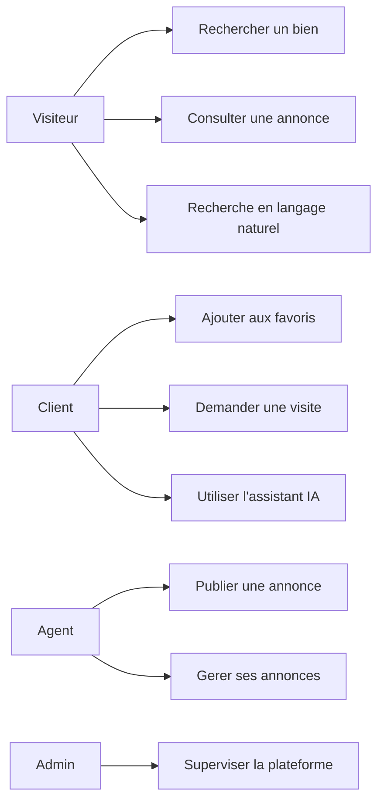
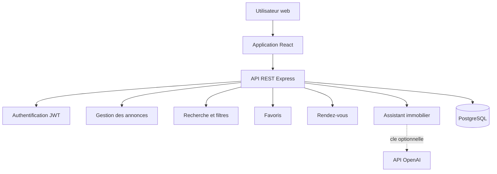

# Rapport de Projet de Fin d'Etudes

## Conception et développement d'une plateforme immobiliere intelligente
## Dari.tn

**Etudiant :** [Nom et prenom]

**Etablissement :** [Nom de l'etablissement]

**Encadrant academique :** [Nom de l'encadrant]

**Encadrant professionnel :** [Nom de l'encadrant]

**Annee universitaire :** 2025 / 2026

---

# Remerciements

Je tiens a remercier toutes les personnes qui ont contribue a la realisation de ce projet de fin d'etudes, en particulier mon encadrant academique, mon encadrant professionnel et l'ensemble des enseignants de [nom de l'etablissement]. Je remercie egalement les personnes ayant participe aux phases de conception, de test et de validation de la plateforme Dari.tn.

---

# Resume

Le projet Dari.tn consiste a concevoir et developper une plateforme web dediee a la publication, la recherche et la gestion d'annonces immobilieres en Tunisie. La solution reunit un espace public de consultation, un espace client, un espace agent immobilier et un espace d'administration.

L'application permet aux utilisateurs de rechercher des biens selon plusieurs criteres, de consulter leur localisation sur une carte, d'ajouter des annonces aux favoris et de demander un rendez-vous de visite. Les agents peuvent publier des biens, gerer leurs annonces et suivre les demandes de rendez-vous. Les administrateurs disposent de fonctions de supervision des utilisateurs et des publications.

Une dimension intelligente a ete integree au projet. Un assistant immobilier peut repondre aux questions relatives a une annonce, proposer des biens similaires et utiliser l'API OpenAI lorsque la cle de configuration est disponible. La recherche en langage naturel transforme une demande libre en filtres immobiliers exploitables. Un mode local de secours permet de conserver un fonctionnement minimal lorsque le service IA n'est pas disponible.

**Mots-cles :** immobilier, Tunisie, React, Node.js, PostgreSQL, API REST, JWT, recherche intelligente, OpenAI.

---

# Abstract

Dari.tn is a web platform designed for publishing, searching and managing real-estate listings in Tunisia. The solution provides a public interface, a customer area, a real-estate agent area and an administration area.

The platform supports advanced listing search, map visualization, favorites, property details and visit appointments. Agents can publish and manage properties, while administrators supervise users and listings.

Artificial intelligence features were also integrated into the solution. The real-estate assistant answers questions about a property, recommends similar listings and can use the OpenAI API. Natural-language search converts a user's free-text request into structured real-estate filters. A local fallback keeps the service available when the AI provider is unavailable.

**Keywords:** real estate, Tunisia, React, Node.js, PostgreSQL, REST API, JWT, intelligent search, OpenAI.

---

# Sommaire

1. Introduction generale
2. Contexte general et presentation du projet
3. Analyse des besoins
4. Conception de la solution
5. Architecture technique
6. Realisation de la plateforme
7. Integration de l'intelligence artificielle
8. Tests et validation
9. Deploiement et securite
10. Limites et perspectives
11. Conclusion generale

---

# Liste des figures

- Figure 1 : Architecture generale de Dari.tn
- Figure 2 : Diagramme des acteurs et cas d'utilisation
- Figure 3 : Architecture applicative
- Figure 4 : Processus de recherche intelligente
- Figure 5 : Processus d'ajout d'un favori
- Figure 6 : Processus de demande de rendez-vous

# Liste des tableaux

- Tableau 1 : Acteurs du systeme
- Tableau 2 : Technologies utilisees
- Tableau 3 : Principales tables de la base de donnees
- Tableau 4 : Principaux endpoints de l'API
- Tableau 5 : Resultats des tests

---

# 1. Introduction generale

## 1.1 Contexte

Le secteur immobilier tunisien rassemble un nombre important d'acteurs et d'offres, mais les informations restent souvent dispersees entre agences, reseaux sociaux et plateformes generalistes. Cette dispersion rend la recherche difficile pour les clients et limite la visibilite des agents immobiliers.

Les utilisateurs recherchent aujourd'hui une experience plus rapide, plus fiable et mieux adaptee a leurs besoins. Ils souhaitent pouvoir filtrer les annonces, visualiser les biens sur une carte, sauvegarder leurs coups de coeur et contacter facilement les annonceurs.

## 1.2 Problematique

Comment concevoir une plateforme immobiliere centralisee, securisee et evolutive permettant aux utilisateurs de trouver rapidement un bien, aux agents de publier leurs offres et aux administrateurs de superviser l'activite ?

Une seconde question concerne l'accompagnement de l'utilisateur : comment permettre une recherche exprimee en langage naturel et proposer une aide intelligente sans rendre la plateforme dependante d'un unique fournisseur externe ?

## 1.3 Objectifs du projet

Les objectifs principaux sont les suivants :

- centraliser les annonces immobilieres tunisiennes ;
- proposer une recherche multicritere et full-text ;
- afficher les biens sur une carte interactive ;
- gerer l'authentification et les roles utilisateurs ;
- permettre la publication et la gestion des annonces ;
- enregistrer les favoris dans PostgreSQL ;
- gerer les demandes de rendez-vous ;
- fournir un assistant immobilier ;
- proposer une recherche en langage naturel ;
- garantir une architecture maintenable et deployable.

## 1.4 Methodologie

Le projet a ete realise de maniere incrementale. Les principales etapes ont ete :

1. analyse du besoin et definition du perimetre ;
2. conception des acteurs, des cas d'utilisation et de la base de donnees ;
3. developpement de l'API backend ;
4. developpement de l'interface React ;
5. integration de la carte, des favoris et des rendez-vous ;
6. integration des fonctionnalites IA ;
7. tests fonctionnels et validation du build ;
8. preparation au deploiement.

---

# 2. Contexte general et presentation du projet

## 2.1 Presentation de Dari.tn

Dari.tn est une application web full-stack de vente et de location immobiliere en Tunisie. Elle met en relation les visiteurs, les clients, les proprietaires, les agents immobiliers et les administrateurs.

La plateforme comprend les espaces suivants :

- **espace public :** consultation et recherche des annonces ;
- **espace client :** favoris, profil et demandes de rendez-vous ;
- **espace agent :** publication et gestion des biens ;
- **espace administrateur :** supervision des comptes et annonces ;
- **assistant immobilier :** questions, aide a la recherche et recommandations.

## 2.2 Acteurs

| Acteur | Responsabilites |
|---|---|
| Visiteur | Consulter et rechercher les annonces publiques |
| Client | Gerer son profil, ses favoris et ses rendez-vous |
| Agent | Publier les biens et gerer les demandes de visite |
| Administrateur | Superviser les utilisateurs et les annonces |
| Service IA | Analyser les demandes et assister l'utilisateur |

## 2.3 Perimetre fonctionnel

Le projet couvre la gestion des comptes, des annonces, des images, des favoris, des rendez-vous, de la recherche, de la carte et de l'assistance immobiliere.

Le paiement en ligne, le CRM multi-agences, l'estimation automatique certifiee des prix et l'analyse anti-fraude avancee sont consideres comme des evolutions futures.

---

# 3. Analyse des besoins

## 3.1 Besoins fonctionnels

### Gestion des utilisateurs

- inscription ;
- connexion ;
- authentification JWT ;
- renouvellement de session ;
- gestion du profil ;
- gestion des roles.

### Gestion des annonces

- creation d'une annonce ;
- modification d'une annonce ;
- suppression d'une annonce ;
- changement de statut ;
- ajout d'images ;
- choix de l'image de couverture ;
- consultation du detail d'une annonce.

### Recherche immobiliere

- recherche par mots-cles ;
- filtres par ville et gouvernorat ;
- filtres par prix et surface ;
- filtres par type et transaction ;
- filtres par nombre de pieces ;
- filtres parking, piscine, meuble et neuf ;
- tri et pagination ;
- affichage en liste, grille et carte ;
- recherche en langage naturel.

### Favoris et rendez-vous

- ajout d'un favori ;
- retrait d'un favori ;
- consultation de la page Mes favoris ;
- demande de visite ;
- suivi du statut d'un rendez-vous.

### Intelligence artificielle

- questions sur une annonce ;
- reponses sur le prix, la surface, la localisation et la disponibilite ;
- recommandations d'annonces similaires ;
- extraction de filtres depuis une phrase libre ;
- fonctionnement de secours par regles locales.

## 3.2 Besoins non fonctionnels

- securite des routes protegees ;
- validation des donnees envoyees ;
- gestion centralisee des erreurs ;
- journalisation des evenements ;
- interface responsive ;
- temps de reponse acceptable ;
- code modulaire et maintenable ;
- compatibilite avec un deploiement Nginx et PM2.

## 3.3 Cas d'utilisation principal



---

# 4. Conception de la solution

## 4.1 Architecture fonctionnelle



## 4.2 Conception de la base de donnees

| Table | Role |
|---|---|
| users | Comptes, roles et informations utilisateur |
| listings | Informations principales des annonces |
| listing_images | Images associees aux annonces |
| favorites | Relation entre utilisateurs et annonces favorites |
| appointments | Demandes et statuts de rendez-vous |
| messages | Messages envoyes a un annonceur |
| refresh_tokens | Gestion des sessions renouvelees |

La table `favorites` utilise une cle primaire composee de `user_id` et `listing_id`. Cette contrainte empeche un utilisateur d'enregistrer deux fois la meme annonce. Les cles etrangeres assurent egalement la suppression automatique des favoris lorsqu'un utilisateur ou une annonce est supprime.

## 4.3 Processus d'ajout d'un favori

1. L'utilisateur clique sur le coeur d'une carte annonce.
2. Le frontend envoie `POST /api/favorites/:listingId`.
3. Le middleware verifie le token JWT.
4. Le backend verifie l'existence de l'annonce.
5. Le favori est cree ou supprime selon son etat precedent.
6. La page des favoris est actualisee.

## 4.4 Processus de recherche intelligente

1. L'utilisateur saisit une phrase libre.
2. Le frontend envoie la phrase a `POST /api/search/natural`.
3. Le backend utilise OpenAI si une cle est disponible.
4. Sinon, un parseur local reconnait les villes, prix, types et options.
5. Les filtres sont retournes au frontend.
6. La recherche classique est executee avec ces filtres.

---

# 5. Architecture technique

## 5.1 Technologies

| Couche | Technologie |
|---|---|
| Frontend | React 18, Vite 5 |
| Routage | React Router v6 |
| Etat et cache | Zustand, React Query |
| Styles | CSS Modules |
| Carte | Leaflet et React Leaflet |
| Backend | Node.js, Express 4 |
| ORM | Sequelize 6 |
| Base de donnees | PostgreSQL 16 |
| Authentification | JWT |
| Images | Cloudinary ou stockage local |
| IA | OpenAI API avec modele gpt-4o-mini |
| Serveur | Nginx et PM2 |

## 5.2 Organisation backend

Le backend est organise par responsabilite :

- `controllers` contient la logique applicative ;
- `routes` definit les endpoints ;
- `models` definit les tables et associations ;
- `middlewares` gere l'authentification, la validation et les erreurs ;
- `config` contient la connexion et les scripts de base de donnees ;
- `utils` regroupe les fonctions partagees.

## 5.3 Organisation frontend

Le frontend est compose de pages, de composants reutilisables, de hooks React Query, d'un store d'authentification et de modules CSS. Les appels HTTP sont centralises dans le client Axios et les fichiers API.

## 5.4 Principaux endpoints

| Methode | Endpoint | Description |
|---|---|---|
| POST | `/api/auth/login` | Connexion |
| POST | `/api/auth/register` | Inscription |
| GET | `/api/listings` | Liste des annonces |
| GET | `/api/listings/:id` | Detail d'une annonce |
| POST | `/api/listings` | Creation d'une annonce |
| GET | `/api/search` | Recherche full-text |
| POST | `/api/search/natural` | Recherche en langage naturel |
| GET | `/api/favorites` | Liste des favoris |
| POST | `/api/favorites/:listingId` | Ajouter ou retirer un favori |
| POST | `/api/chatbot` | Question a l'assistant |
| POST | `/api/appointments` | Demande de rendez-vous |

---

# 6. Realisation de la plateforme

## 6.1 Interface d'accueil

La page d'accueil presente le service Dari.tn, permet de lancer une recherche et met en avant les annonces disponibles. La navigation donne acces aux espaces de recherche, de publication, de connexion et de favoris.

## 6.2 Recherche et carte

La page de recherche propose trois modes d'affichage : grille, liste et vue partagee avec carte. Les filtres sont transmis a l'API et les resultats sont pagines. La carte affiche les biens disposant de coordonnees geographiques.

## 6.3 Fiche annonce

La fiche annonce presente le prix, le type de transaction, la localisation, la surface, le nombre de pieces, les equipements, les photos et les informations de contact. Elle integre aussi le bouton de favori, la demande de visite et l'assistant immobilier.

## 6.4 Gestion des favoris

Les favoris sont persistants et associes au compte connecte. Lorsqu'un utilisateur ajoute une annonce, elle est enregistree dans PostgreSQL. La page `Mes favoris` recupere les annonces avec `GET /api/favorites`.

## 6.5 Rendez-vous

Le client peut demander une visite a partir d'une annonce. L'agent consulte les demandes et peut faire evoluer leur statut selon le processus metier.

## 6.6 Administration

L'espace d'administration permet de consulter les utilisateurs et de superviser les annonces. Les routes sensibles sont protegees par le role administrateur.

---

# 7. Integration de l'intelligence artificielle

## 7.1 Assistant immobilier

Le chatbot est accessible depuis la fiche annonce. L'utilisateur peut demander le prix, la surface, le nombre de pieces, la disponibilite, la localisation ou une visite.

Lorsque `OPENAI_API_KEY` est configuree, le backend envoie la question a OpenAI avec le contexte de l'annonce. Le modele utilise est `gpt-4o-mini`. La cle reste uniquement cote serveur et n'est jamais exposee au frontend.

## 7.2 Recommandations similaires

Apres une question, le backend recherche jusqu'a quatre annonces actives partageant des caracteristiques avec l'annonce courante :

- ville ;
- type de bien ;
- type de transaction.

Les resultats sont affiches dans le chatbot et sont cliquables.

## 7.3 Recherche en langage naturel

L'endpoint `POST /api/search/natural` recoit une phrase comme :

> Je cherche un appartement a Tunis a moins de 250000 DT avec deux chambres et parking.

La reponse contient les filtres suivants :

```json
{
  "property_type": "Appartement",
  "city": "Tunis",
  "max_price": 250000,
  "rooms": 2,
  "has_parking": true
}
```

Ces filtres sont ensuite appliques a la recherche classique. L'utilisation d'un fallback local permet de continuer a fonctionner sans cle OpenAI.

## 7.4 Limites de l'IA actuelle

Les resultats de l'IA dependent de la qualite des donnees et de la disponibilite du fournisseur. Le systeme ne doit pas presenter une estimation de prix comme une expertise officielle. Les futures versions devront ajouter une limitation de debit, un suivi du cout et une protection contre les abus.

---

# 8. Tests et validation

## 8.1 Tests realises

| Test | Resultat attendu | Resultat |
|---|---|---|
| Connexion PostgreSQL | Connexion acceptee | Reussi |
| Ajout d'un favori | Ligne creee dans `favorites` | Reussi |
| Retrait d'un favori | Ligne supprimee | Reussi |
| Lecture des favoris | Liste retournee par l'API | Reussi |
| Recherche naturelle locale | Filtres extraits sans cle IA | Reussi |
| Recherche naturelle IA | JSON de filtres structure | Prevu avec cle API |
| Recommandations | Annonces similaires retournees | Reussi |
| Build frontend | Compilation Vite sans erreur | Reussi |
| Verification JavaScript backend | Syntaxe valide | Reussi |

## 8.2 Validation du build

Le build frontend est realise avec la commande :

```bash
npm run build
```

La compilation Vite s'est terminee sans erreur. Les controles de syntaxe Node.js ont egalement ete executes sur les controleurs modifies.

## 8.3 Tests manuels recommandes

1. Se connecter avec un compte utilisateur.
2. Ouvrir une annonce.
3. Cliquer sur le coeur.
4. Verifier la redirection vers `/favoris`.
5. Recharger la page et verifier la persistance.
6. Saisir une recherche naturelle dans `/recherche`.
7. Ouvrir une annonce et poser une question au chatbot.
8. Cliquer sur une recommandation similaire.

---

# 9. Deploiement et securite

## 9.1 Configuration locale

Le backend utilise un fichier `.env` contenant notamment les informations PostgreSQL, le secret JWT et la cle OpenAI optionnelle. La cle OpenAI ne doit jamais etre committee dans Git.

## 9.2 Deploiement

Le deploiement cible s'appuie sur un serveur VPS Linux, Nginx comme reverse proxy et PM2 comme gestionnaire de processus. Le frontend est compile puis servi comme fichiers statiques.

## 9.3 Mesures de securite

- mots de passe haches ;
- tokens JWT ;
- verification des roles ;
- validation des donnees ;
- limitation du nombre de requetes ;
- protection HTTP via Helmet ;
- configuration CORS ;
- secrets dans les variables d'environnement ;
- requetes SQL parametrees pour les recherches dynamiques.

---

# 10. Limites et perspectives

## 10.1 Limites

- l'analyse IA depend d'une cle et d'un service externe ;
- le parseur local reconnait un nombre limite de villes et de formulations ;
- les recommandations actuelles reposent sur des criteres simples ;
- aucune estimation de prix certifiee n'est fournie ;
- les tests automatises frontend et backend peuvent encore etre enrichis.

## 10.2 Evolutions envisagees

- generation automatique de titres et descriptions ;
- traduction francais-arabe des annonces ;
- recherche vocale ;
- score de compatibilite entre utilisateur et annonce ;
- estimation statistique des prix ;
- detection des annonces dupliquees ou suspectes ;
- analyse automatique de la qualite des photos ;
- notifications pour les nouvelles annonces ;
- tableau de bord analytique pour les agents ;
- tests end-to-end automatises avec Playwright.

---

# 11. Conclusion generale

Le projet Dari.tn a permis de concevoir et de developper une plateforme immobiliere complete adaptee au contexte tunisien. La solution couvre les besoins essentiels de consultation, recherche, publication, authentification, favoris, rendez-vous et administration.

L'architecture choisie, basee sur React, Node.js, Express et PostgreSQL, offre une separation claire entre l'interface, l'API et les donnees. Les fonctionnalites de recherche multicritere, de cartographie et de gestion des favoris ameliorent l'experience utilisateur.

L'ajout d'un assistant immobilier et d'une recherche en langage naturel apporte une dimension intelligente a la plateforme. Le choix d'un fallback local limite l'indisponibilite lorsque l'API externe n'est pas configuree. Le projet constitue ainsi une base evolutive pouvant accueillir des services IA plus avances, tout en conservant une architecture robuste et maintenable.

---

# Bibliographie et ressources

- Documentation officielle React : https://react.dev/
- Documentation officielle Node.js : https://nodejs.org/
- Documentation Express : https://expressjs.com/
- Documentation PostgreSQL : https://www.postgresql.org/docs/
- Documentation Sequelize : https://sequelize.org/docs/v6/
- Documentation OpenAI API : https://platform.openai.com/docs/
- Documentation Leaflet : https://leafletjs.com/reference.html

# Annexes

## Annexe A - Commandes de lancement

```bash
# Backend
cd dari-tn-fullstack/dari-tn-backend
npm install
npm run dev

# Frontend
cd dari-tn-fullstack/dari-tn-frontend
npm install
npm run dev
```

## Annexe B - Exemple de recherche naturelle

```json
{
  "message": "Je cherche une villa a La Marsa avec piscine et parking"
}
```

## Annexe C - Exemple de reponse IA

```json
{
  "success": true,
  "data": {
    "reply": "Le bien est situe a La Marsa...",
    "mode": "ai",
    "recommendations": []
  }
}
```

## Annexe D - Informations a completer

- nom et prenom de l'etudiant ;
- nom de l'etablissement ;
- nom des encadrants ;
- logo de l'etablissement ;
- captures d'ecran de l'application ;
- diagrammes UML definitifs ;
- calendrier reel du projet ;
- bibliographie imposee par l'etablissement.
